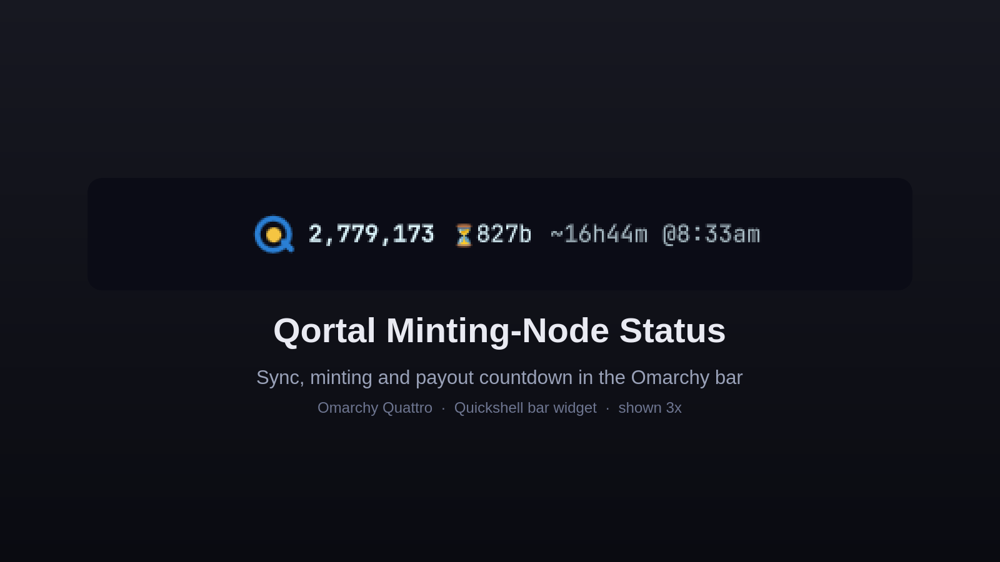

# Qortal Minting-Node Status — Omarchy Bar Widget

A Quickshell bar widget for Omarchy that shows your Qortal blockchain node's sync, minting, and payout status. The old KDE tray applet, reborn for Omarchy.



## Requirements

This widget is a **window onto a Qortal Core node you run yourself** — it has no
node of its own. Two things must be true before it shows anything:

1. **Qortal Core must be installed and running** on the same machine, and fully
   synced. Without a local node answering its admin API, the widget hides itself
   (that is its "node down" state).
2. **A minting account must be added to that node for the *minting* indicators
   to mean anything.** Sync, block height and the payout countdown work as soon
   as the node is synced; the gold "minting" center and the `✦paid` status need a
   minting account registered on the node. (The widget reads that account from
   the node automatically — see Configuration.)

Because it needs a local node, this plugin has **no one-command install**. The
Omarchy Plugin Marketplace therefore lists it as **Manual setup**. Install it by
hand, below.

## Installation

The manifest id is `io.github.tydynrain369.qortal-minting-node-status`, and the
plugin directory name must match it:

```bash
git clone https://github.com/tydynrain369/omarchy-qortal-plugin.git ~/.config/omarchy/plugins/io.github.tydynrain369.qortal-minting-node-status
omarchy restart shell
```

## Configuration

**Usually none.** The widget auto-discovers what it needs from the local node:

| What | Where it comes from | Fallback |
|---|---|---|
| Admin API port | `apiPort` in the node's `~/qortal/settings.json` | `12391` (Qortal's default) |
| Monitored (minting) address | the node's own `/admin/mintingaccounts` endpoint | `fallbackAddress` constant, else none |

Qortal writes only *non-default* keys to `settings.json`, so a missing `apiPort`
simply means the default `12391`. The monitored address is taken from the node's
own minting configuration — **you do not normally set it yourself**. If you want
to watch a *different* address (e.g. a non-minting wallet), set `fallbackAddress`
in `BarWidget.qml` to your Qortal address; it is used only when the node reports
no minting account.

The remaining knobs are constants in `BarWidget.qml`:

| What | Constant | Default |
|---|---|---|
| Qortal Hub launcher (left-click) | `hubPath` | `~/AppImages/qortal_hub.appimage` |
| Override watched address | `fallbackAddress` | empty (fully automatic) |
| Refresh interval | `Timer` | 30 s |

Edit those and run `omarchy restart shell` to apply. The widget talks **only** to
the node's HTTP API and never reads the node's files, so your Qortal **node
core** can live anywhere (its default install location is `~/qortal`). The
left-click opens **Qortal Hub**, the desktop UI, which is a separate program from
the node.

### Features

All behavior below is implemented in `BarWidget.qml`:

- **Color-coded Q-logo**: Red = not synced (or node down), Blue = synced, Blue ring + gold center = synced and minting
- **Block height**: Live chain height from the admin API, refreshed every 30 s
- **Payout countdown**: Deterministic — every 1000th block is a payout block, so the countdown is `next multiple of 1000 − height`
- **Measured ETA**: Uses the real average block time measured since the last payout block (self-correcting each refresh)
- **Payout indicators**: `✦hunt` on the payout block itself, `✦paid` for a few blocks after a confirmed balance jump (needs a monitored address — auto-detected, see above)
- **Auto-hide**: The widget vanishes when the node is down
- **Left-click**: Opens your Qortal Hub install (see `hubPath`)
- **Right-click**: Refreshes status immediately
- **State persistence**: Balance baseline and last payout are saved to `~/.local/state/omarchy/qortal-widget.json` so restarts never miss a payout that landed in between

## API Requirements

The widget connects to the Qortal **admin** API on `http://localhost:<apiPort>`
(12391 by default). Make sure:

- `apiRestricted` is `false` in your `settings.json` (the default)
- Your `apiPort`, if changed from `12391`, is the value in `settings.json`

## Removing

```bash
omarchy plugin remove io.github.tydynrain369.qortal-minting-node-status
```

## Qortal info & downloads

- **Website** — <https://qortal.org/>
- **Get started** — <https://qortal.org/get-started>
- **Downloads** (Qortal Hub + Qortal Core) — <https://qortal.dev/downloads>
- **Wiki** — <https://wiki.qortal.org/> (node-setup guides for Linux, macOS, Windows, Raspberry Pi; see also the [Linux page](https://wiki.qortal.org/doku.php?id=linux))
- **Qortal Core source** — <https://github.com/Qortal/qortal>

## License

MIT — see [LICENSE](LICENSE).
